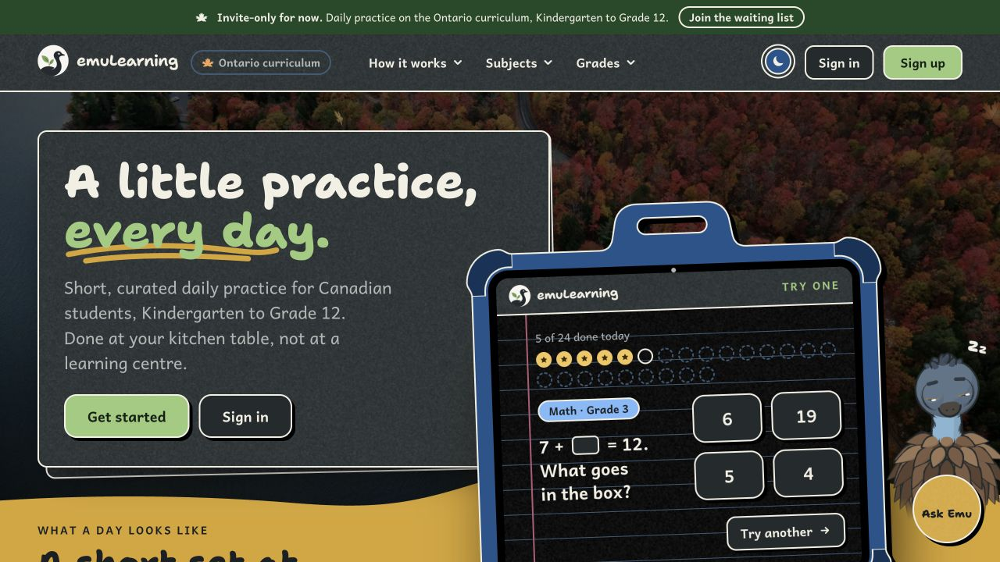
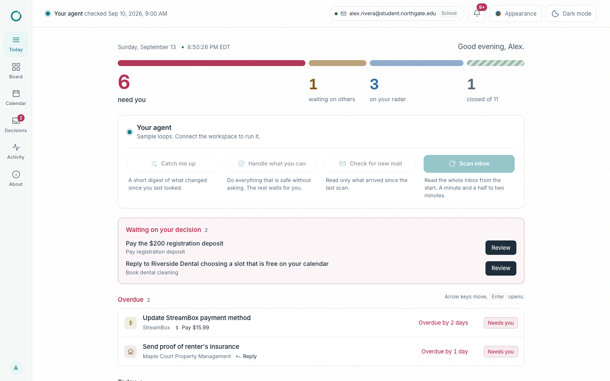
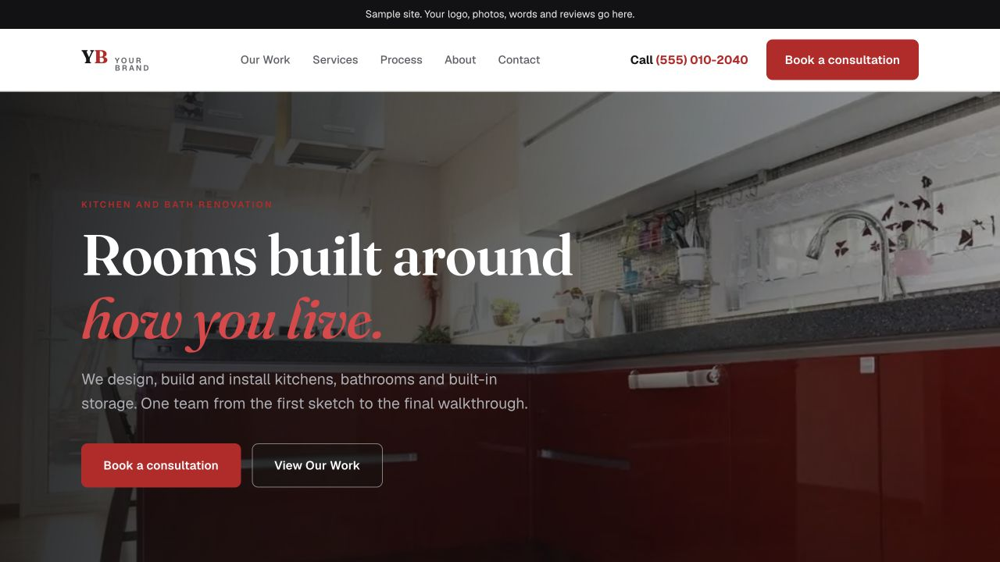
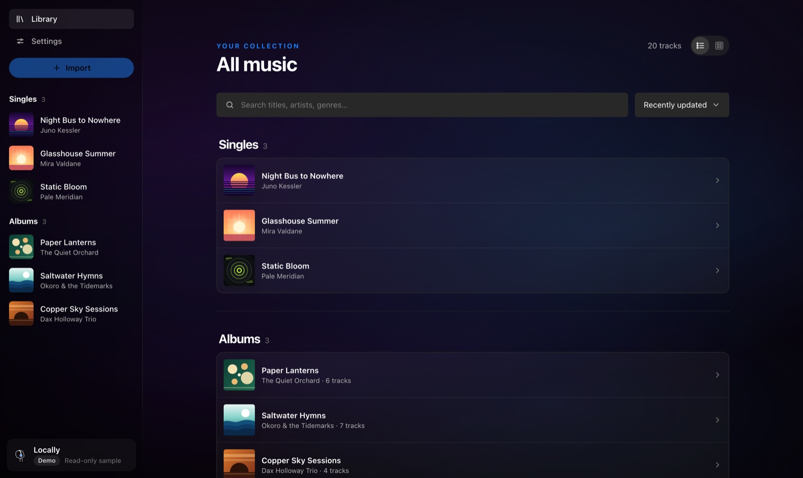

  

  <strong><a href="#selected-work">Selected work</a> &nbsp; · &nbsp; <a href="#about">About</a> &nbsp; · &nbsp; <a href="mailto:dareoluwatoby@gmail.com">Email</a></strong>

<h2 id="about">About</h2>

**Hi, I’m Toby Dare.**

I build web applications, AI-assisted tools, and websites for businesses. My projects span daily learning, following through on commitments, and making personal tools easier to use.

  
  
  
  

 

<h2 id="selected-work">Selected work</h2>

A few things I’m building, and work I’ve helped bring to life.

<table>
  <tr>
    <td width="50%" valign="top">
      
      <h3>emuLearning</h3>
      
🟢 Live

      

        Curated daily practice for Canadian students,
        with learner setup and server-marked sessions.
        Questions are human-authored and expanded through templates.
      

      

        
          Next.js · TypeScript · PostgreSQL · Prisma · Clerk
        
      

      

        <a href="https://www.emulearning.com">Visit emuLearning →</a>
      

    </td>
    <td width="50%" valign="top">
      
      <h3>Open Loops</h3>
      
🟡 In development

      

        A team demo for the AWS Agents for Humans hackathon.
        Tracks responsibilities across email and calendar with evidence
        and risk-based approvals, using a fictional demo inbox.
      

      

        
          Next.js · TypeScript · Strands Agents · Amazon Bedrock · DynamoDB
        
      

      

        <a href="https://github.com/Omggdavidd/openloops">Explore the source →</a>
      

    </td>
  </tr>
  <tr>
    <td width="50%" valign="top">
      
      <h3>YourBrand</h3>
      
🟡 In development

      

        A website example built for a client working on kitchens,
        bathrooms, and built-ins. Responsive presentation and an
        enquiry form give the work a clear home online.
      

      

        
          HTML · CSS · JavaScript · Vercel · Resend
        
      

      

        <a href="https://yourbrand-showcase.vercel.app">Visit the website →</a>
      

    </td>
    <td width="50%" valign="top">
      
      <h3>Locally</h3>
      
🟡 In development

      

        A Mac music library tool with an iPhone companion.
        Imports audio, manages metadata and artwork, and prepares
        music for Spotify Local Files.
      

      

        
          Next.js · TypeScript · SwiftUI
        
      

      

        <a href="https://locally-web-liard.vercel.app">Try the live demo →</a> &nbsp; · &nbsp;
        <a href="https://github.com/tdare514/locally">Explore the source →</a>
      

    </td>
  </tr>
</table>

 

  

Always open to discuss bold ideas and software that solves real problems.

 

  Toby Dare · <a href="https://github.com/tdare514">@tdare514</a>

