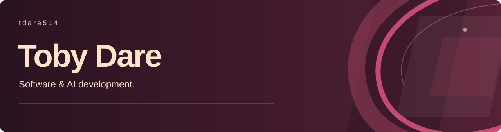
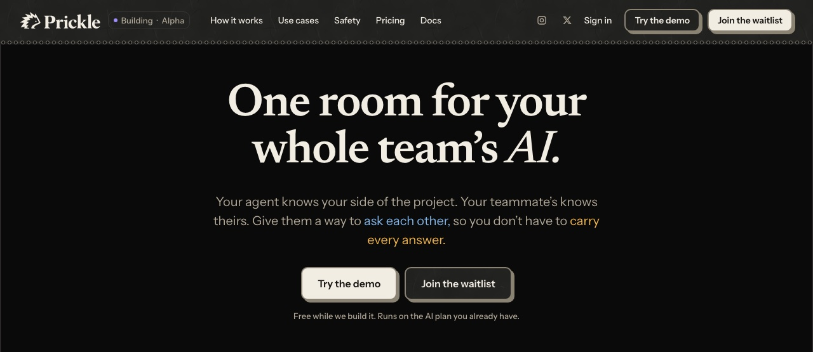
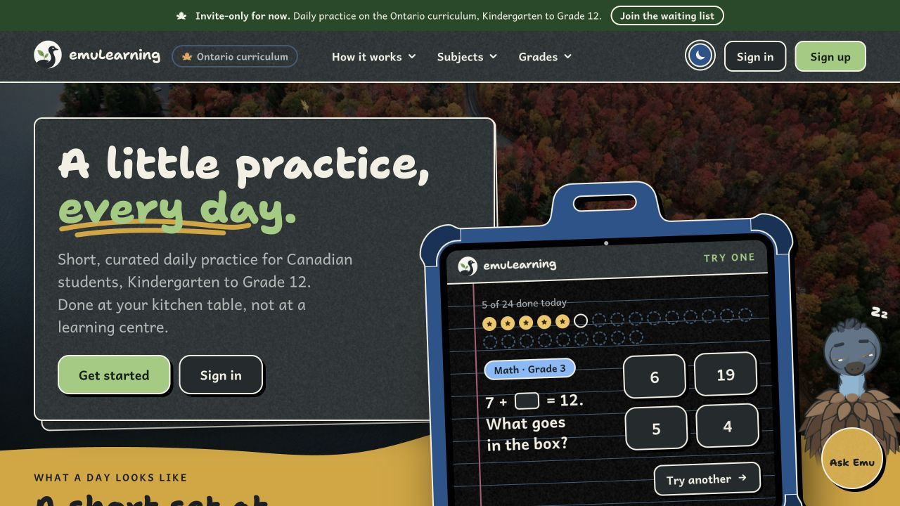
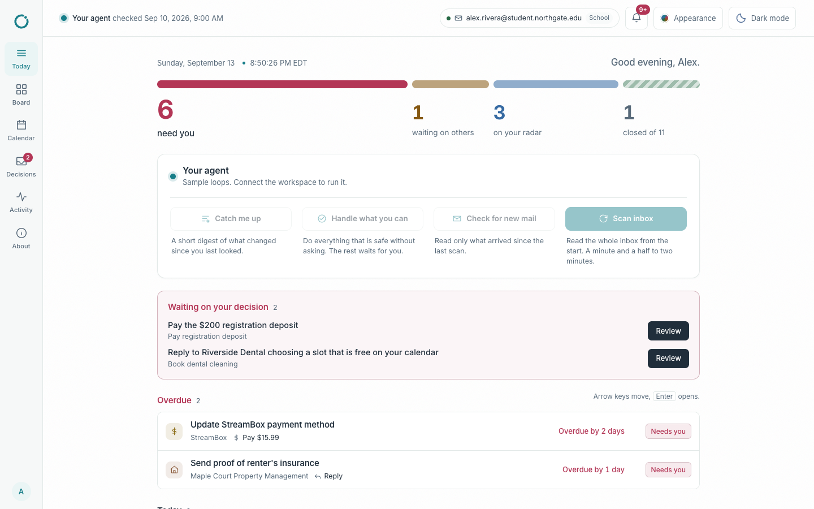

  

  <strong><a href="https://toby-dare-portfolio.tdare514.chatgpt.site">Portfolio</a> &nbsp; · &nbsp; <a href="#selected-work">Selected work</a> &nbsp; · &nbsp; <a href="#about">About</a> &nbsp; · &nbsp; <a href="mailto:dareoluwatoby@gmail.com">Email</a></strong>

<h2 id="about">About</h2>

**Hi, I’m Toby Dare.**

I build web applications, AI-assisted tools, and websites for businesses. I’m a co-founder of Prickle and Open Loops. My projects span daily learning, following through on commitments, and getting a team’s AI agents to work together.

  
  
  
  

 

<h2 id="selected-work">Selected work</h2>

A few things I’m building, and work I’ve helped bring to life. <a href="https://toby-dare-portfolio.tdare514.chatgpt.site">See the full portfolio, including more small-business website demos →</a> · <a href="https://github.com/tdare514/tdare514/blob/main/portfolio/index.html">View its source</a>

<table>
  <tr>
    <td colspan="2" valign="top">
      
      <h3>Prickle</h3>
      
&nbsp; Alpha · co-founder

      

        One room for your whole team’s AI. Prickle connects teammates’ AI agents through shared project rooms,
        so one person’s agent can ask another’s for context, hand off a task and get the result back.
        Each owner’s rules decide what crosses between people, everything that crosses is on the record,
        and agents run on the AI plans people already have.
      

      

        
          TypeScript · Next.js · PostgreSQL · Model Context Protocol
        
      

      

        <a href="https://www.useprickle.dev">Visit Prickle →</a>
      

    </td>
  </tr>
  <tr>
    <td width="50%" valign="top">
      
      <h3>emuLearning</h3>
      
&nbsp; Live

      

        Curated daily practice for Canadian students,
        with learner setup and server-marked sessions.
        Questions are human-authored and expanded through templates.
      

      

        
          Next.js · TypeScript · PostgreSQL · Prisma · Clerk
        
      

      

        <a href="https://www.emulearning.com">Visit emuLearning →</a>
      

    </td>
    <td width="50%" valign="top">
      
      <h3>Open Loops</h3>
      
&nbsp; In development · co-founder

      

        Keeps an evidence-backed ledger of what you still owe people,
        found in your email and calendar. It handles the low-risk items
        and asks you about the rest. Started as our entry for the AWS
        Agents for Humans hackathon; it now runs inside Claude as a skill
        and a local MCP server, with no backend to host.
      

      

        
          TypeScript · Claude skill · MCP · first built on Strands Agents and Amazon Bedrock
        
      

      

        <a href="https://github.com/Omggdavidd/openloops">Explore the hackathon source →</a>
      

    </td>
  </tr>
</table>

 

  

Always open to discuss bold ideas and software that solves real problems.

 

  Toby Dare · <a href="https://github.com/tdare514">@tdare514</a>

